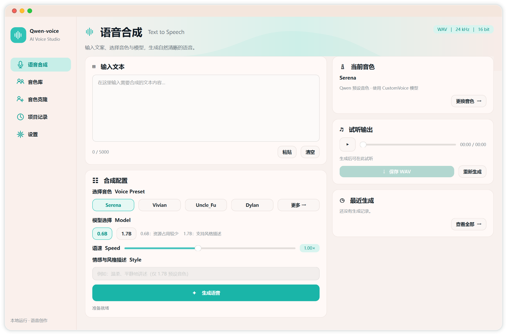

# Qwen-voice

基于 Qwen3-TTS 的本地语音创作应用，包含 Windows 桌面端和 Android 离线测试版源码。界面采用青绿色与奶油粉配色，提供语音合成、参考音色克隆、历史记录和 WAV 导出。

## 功能与当前状态

- Windows：0.6B / 1.7B 预设音色、0.6B 参考音色克隆、语速调整、项目记录与 WAV 导出；1.7B 预设模型支持文字风格描述。
- Android：内置 0.6B 克隆模型与 1.7B 预设音色模型，使用 ARM64 CPU 离线推理；支持录音或导入 WAV、语速调整、项目记录和导出。
- WAV 默认 24 kHz、16 位，可转换为 48 kHz；转换不会增加原始音频的信息。
- Android 测试包已完成构建与签名校验，**尚未在真实手机上完成安装、速度或音质验证**。Android 8.0 / ARM64 是构建配置，不能保证所有符合条件的设备均可运行。
- iOS 当前只有[界面草图](docs/05-mobile-concept.png)和[兼容性准备](docs/iOS-compatibility-plan.md)，没有构建或验证 iOS 应用。

模型权重、用户录音、生成文件、构建缓存和签名密钥不放入 Git 仓库。克隆仓库时请同时初始化原生引擎的子模块：

~~~powershell
git clone --recurse-submodules https://github.com/hansy1026/Qwen-voice.git
~~~

## Windows 源码运行

当前桌面版使用 Windows、Python 3.10 和支持 CUDA / bfloat16 的 NVIDIA GPU。源码运行时默认将模型、设置和输出放在项目目录；也可通过 QWEN_VOICE_HOME 环境变量指定应用数据目录。

安装与本机测试一致的 PyTorch CUDA 版本后，安装桌面依赖：

~~~powershell
python -m pip install torch==2.7.1+cu128 --index-url https://download.pytorch.org/whl/cu128
python -m pip install -r desktop/requirements.txt
python desktop/launch.py
~~~

运行前需从 Qwen 官方模型仓库准备完整模型文件（包括 speech_tokenizer 子目录），并放在以下目录中；缺少文件时应用会提示模型未找到：

~~~text
<应用数据目录>\work\modelscope-cache\models\
  Qwen--Qwen3-TTS-12Hz-0.6B-Base\snapshots\master\
  Qwen--Qwen3-TTS-12Hz-0.6B-CustomVoice\snapshots\master\
  Qwen--Qwen3-TTS-12Hz-1.7B-CustomVoice\snapshots\master\
~~~

模型来源：[0.6B Base](https://huggingface.co/Qwen/Qwen3-TTS-12Hz-0.6B-Base)、[0.6B CustomVoice](https://huggingface.co/Qwen/Qwen3-TTS-12Hz-0.6B-CustomVoice)、[1.7B CustomVoice](https://huggingface.co/Qwen/Qwen3-TTS-12Hz-1.7B-CustomVoice)。模型文件较大，首次准备需要联网；准备后应用使用本地文件。

在已配置相同依赖的环境中，可使用 desktop/Qwen-voice.spec 和 PyInstaller 6.22.3 构建 Windows 目录版；打包脚本已包含 PyInstaller 下的工作目录处理。在其他机器上的完整重建尚未验证。

## Android 源码构建

需要 JDK 17、Android SDK 36、NDK 28.2.13676358 和 CMake 3.22.1。GitHub 仓库不包含大型模型：构建前请从 [Serveurperso/Qwen3-TTS-GGUF](https://huggingface.co/Serveurperso/Qwen3-TTS-GGUF) 下载以下三个文件，放入 android/app/src/main/assets/models/：

| 文件 | SHA-256 |
| --- | --- |
| qwen-talker-0.6b-base-Q4_K_M.gguf | 4b468ec7b1f62b90ef4ca316c0aa57deadfd54b2cf9651703ea753cedaf04226 |
| qwen-talker-1.7b-customvoice-Q4_K_M.gguf | cc328834a631bc08bf9f43e62fa23f8a1383d9b429864ce6690cfb172077fc4a |
| qwen-tokenizer-12hz-Q4_K_M.gguf | cf3788b4d50aaa665fb6e57c170396aae03a3555fea52d2b5d0cda902d658039 |

~~~powershell
cd android
.\gradlew.bat assembleRelease
~~~

当前 release 构建使用 Android 默认调试证书，适合内部测试，不应当视为面向应用商店的正式签名版本。首次启动会将包内模型复制到应用存储并校验，建议预留至少 5 GB 空间。

## 目录

- desktop/：Windows 界面、推理与存储代码、打包配置。
- android/：Android 应用、构建配置、原生引擎子模块。
- docs/：桌面截图与界面设计稿；手机图为设计概念图。

## 许可证与致谢

本项目原创代码按 [MIT License](LICENSE) 发布。Android 代码基于 [Danmoreng/qwen3-tts-android](https://github.com/Danmoreng/qwen3-tts-android)，保留其 [MIT 许可证](android/LICENSE)。原生引擎、GGML、Qwen3-TTS 及模型文件分别使用各自的上游许可证，见 [第三方说明](THIRD_PARTY_NOTICES.md)。